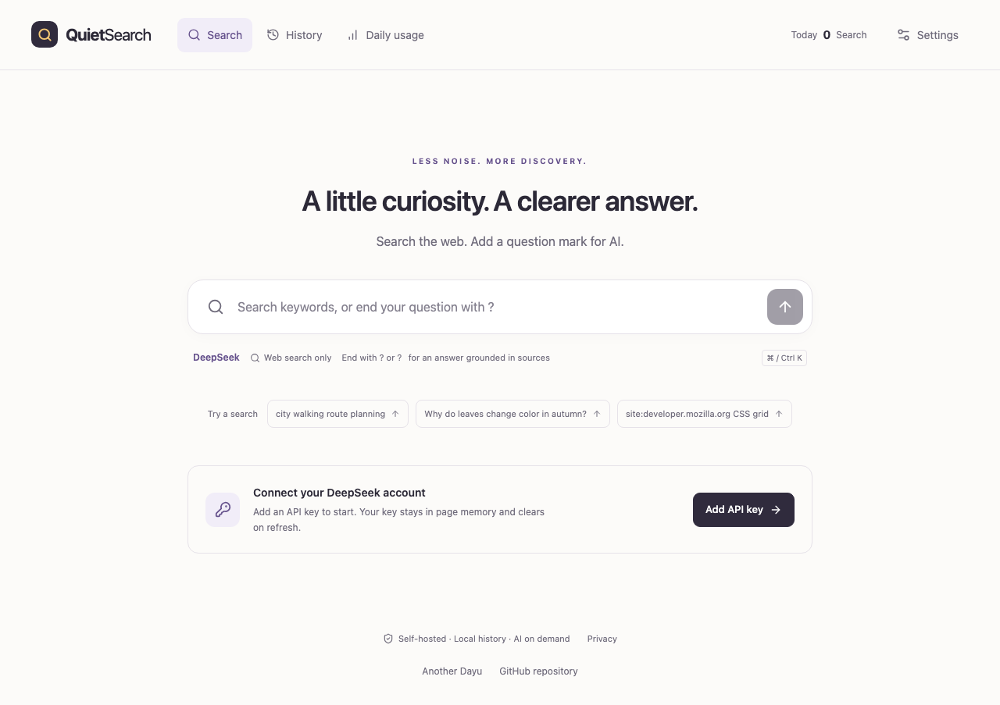
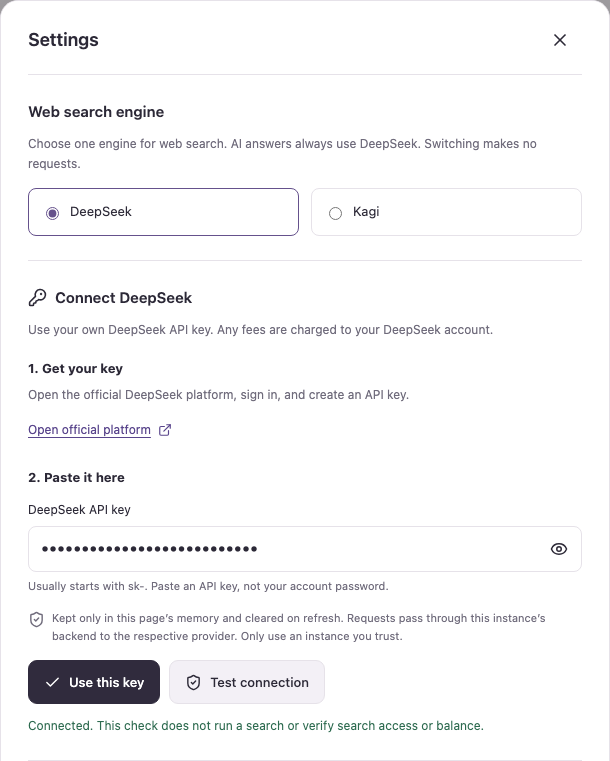
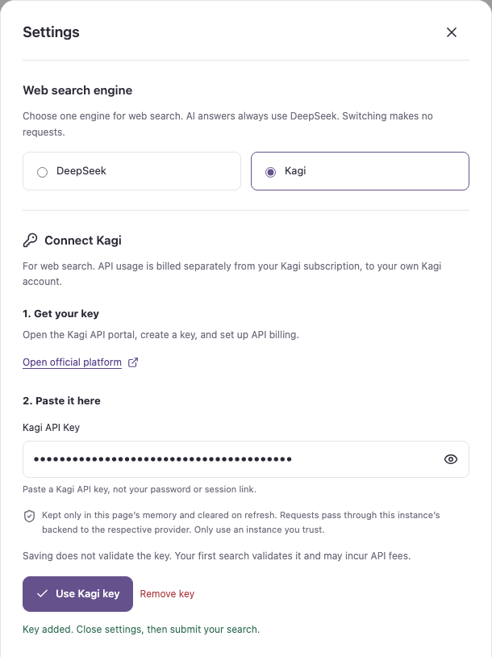
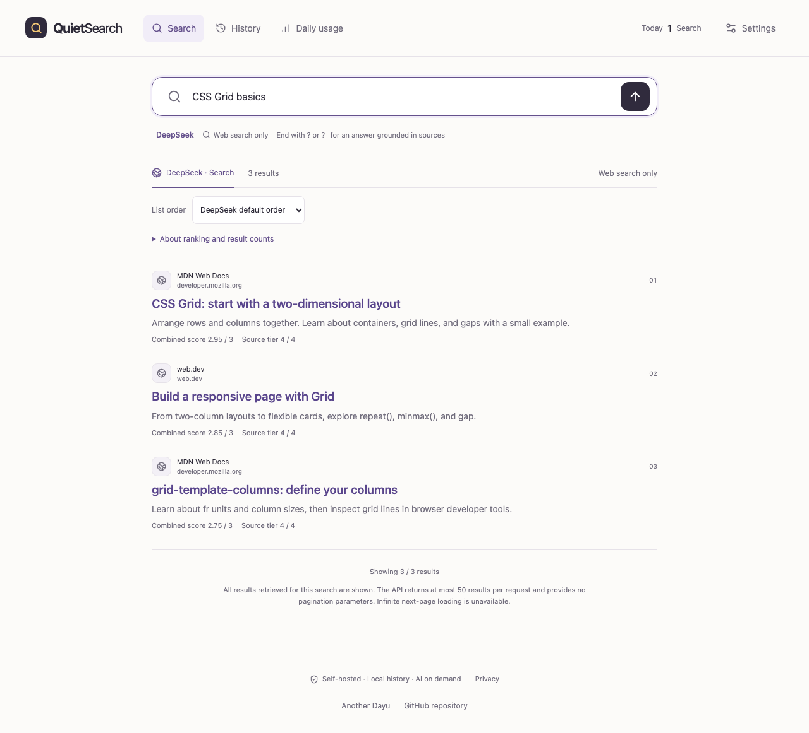
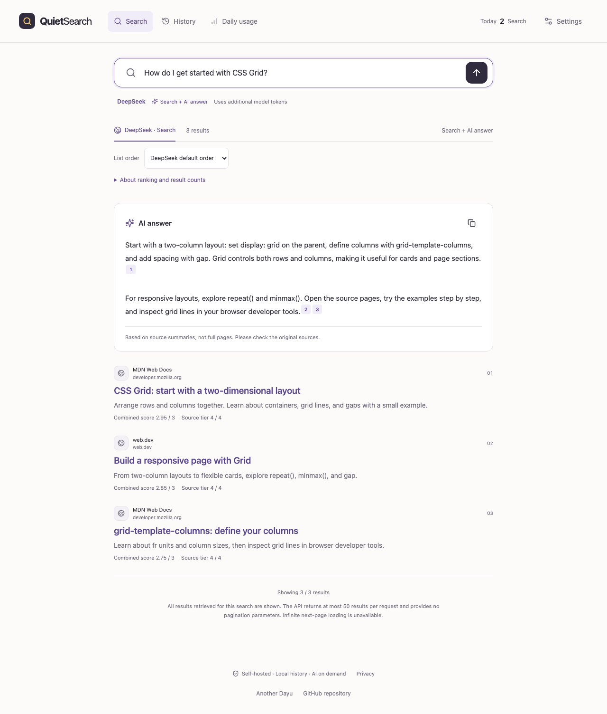
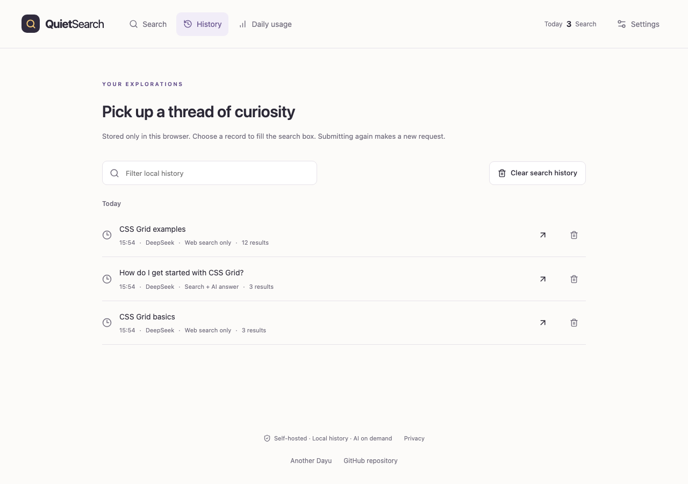
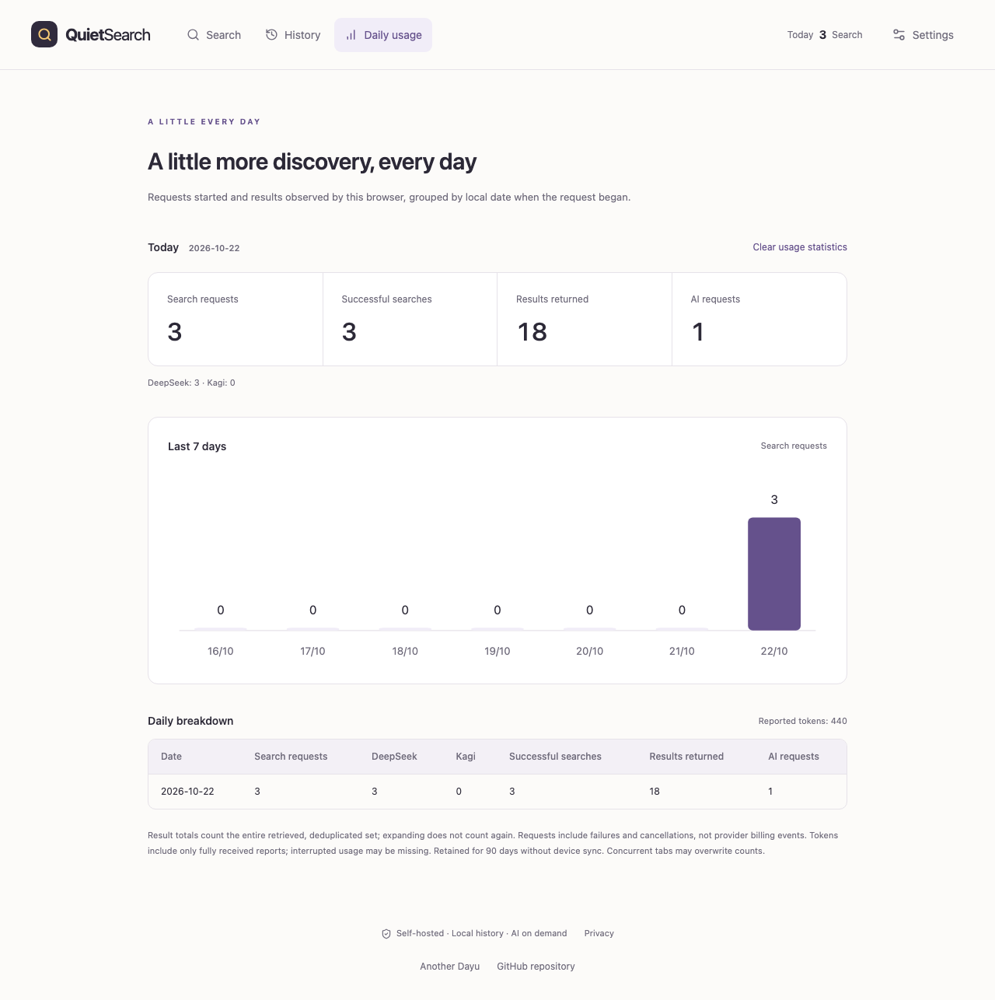
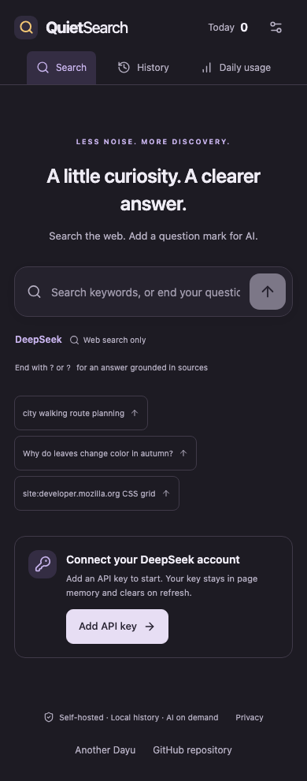

# QuietSearch

[简体中文](README.md) · **English**

Search the web. Add a question mark for AI. A lightweight, self-hosted search app with DeepSeek/Kagi search selection, local history, daily usage, Chinese/English UI, and light/dark themes.

**[Live demo](https://quietsearch.anotherdayu.com)** · [By Another Dayu](https://anotherdayu.com/) · [MIT license](LICENSE)



## Get started

1. Open **Settings → Web search engine** and choose **DeepSeek** (default) or **Kagi**.
2. Create a key on [DeepSeek](https://platform.deepseek.com/api_keys) or [Kagi](https://kagi.com/api/keys), paste it into the matching field, and click **Use this key** / **Use Kagi key**. DeepSeek offers a connection check. Kagi validates the key on your first search, which may incur API fees.
3. Close settings, enter a query, and press **Enter** or click the arrow.

If the demo opens in Chinese, use the settings icon → **界面语言 → English**.

Your key stays in page memory and clears on refresh. Other browsers and devices need their own entry. Requests pass through the instance backend to the selected provider, so use an instance you trust. Searches, AI answers, and retries may incur API fees; the DeepSeek connection check does not verify balance or search access. Kagi API billing is separate from its subscription. Kagi-only search needs no DeepSeek key; AI answers still require one.

<details>
<summary>View API key setup</summary>





</details>

Screenshots show the real UI with synthetic results, answers, connection status, and usage. No real credentials or user records are included.

## Search and AI answers

| Example input                         | What happens              |
| ------------------------------------- | ------------------------- |
| `CSS Grid basics`                     | Web search only           |
| `How do I get started with CSS Grid?` | Search, then an AI answer |

AI runs only when the submitted query ends with `?` or `？`. Typing or choosing a suggestion or history entry never submits automatically.

With Kagi selected, DeepSeek answers use Kagi search results. Without a DeepSeek key, web results remain available; add the key and generate an answer from the same sources without searching again.

Answers use summaries from up to six sources. Click a citation number to open the original page. You can **Stop** generation or **Retry answer** after a failure; retrying keeps the original query and sources without another search.

<details>
<summary>View web search and AI answer screenshots</summary>





</details>

## More results and sorting

Each search requests up to **50 results**, showing **10** initially; settings can change the batch to 20. **Show more results** reveals items already retrieved. Expanding or reordering makes no additional API calls.

The default keeps the selected engine’s order. DeepSeek also offers score, authority, and date sorting; Kagi offers date sorting without invented scores. Fewer results may be returned. This version retrieves one batch and does not yet request Kagi’s next pages. Scores are not fact-accuracy ratings.

<details>
<summary>View the “Show more results” button</summary>


</details>

## History, usage, and appearance

- **History**: filter, reuse, delete, or pause local records. Stored only in this browser, up to 200 entries for 30 days.
- **Daily usage**: searches by DeepSeek/Kagi, result counts, AI requests, and reported tokens, retained for 90 days. No device sync; this is not a provider bill.
- **Settings → Appearance & language**: change theme, language, and batch size. Mobile browsers are supported; **⌘K / Ctrl K** focuses search on desktop.

<details>
<summary>View history, daily usage, and the mobile dark theme</summary>







</details>

## Deploy your own instance

1. [Fork this repository](https://github.com/DayuGuo/QuietSearch/fork).
2. Import it in Cloudflare **Workers & Pages** with the settings below.
3. Open the deployed URL and add your key in the app.

| Setting        | Value                      |
| -------------- | -------------------------- |
| Build command  | `npm run build` — required |
| Deploy command | `npx wrangler deploy`      |
| Root directory | `/`                        |
| Node.js        | `24`                       |

By default, visitors provide their own keys; no Cloudflare `DEEPSEEK_API_KEY` is needed. Storing a server key requires Cloudflare Access authentication; follow the [private deployment guide (Chinese)](docs/private-deployment.md).

## Local development

Requires Node.js 24:

```bash
git clone https://github.com/DayuGuo/QuietSearch.git
cd QuietSearch
npm ci
npm run dev
```

Checks and screenshot updates:

```bash
npm run check
npx playwright install chromium
npm run test:e2e
npm run test:runtime
npm run deploy:check
npm run screenshots
```

Tests and screenshots use synthetic data without paid API calls. The screenshot script generates both languages. `deploy:check` is a dry run; `npm run deploy` publishes to your Cloudflare account.

## Further reading

[Privacy (Chinese)](docs/privacy.md) · [API contract (Chinese)](docs/api-contract.md) · [Verification (Chinese)](docs/verification.md) · [Security (Chinese)](SECURITY.md)

Licensed under [MIT](LICENSE); see [THIRD_PARTY_NOTICES.md](THIRD_PARTY_NOTICES.md) for dependencies. An independent project, not an official Kagi or DeepSeek product.
