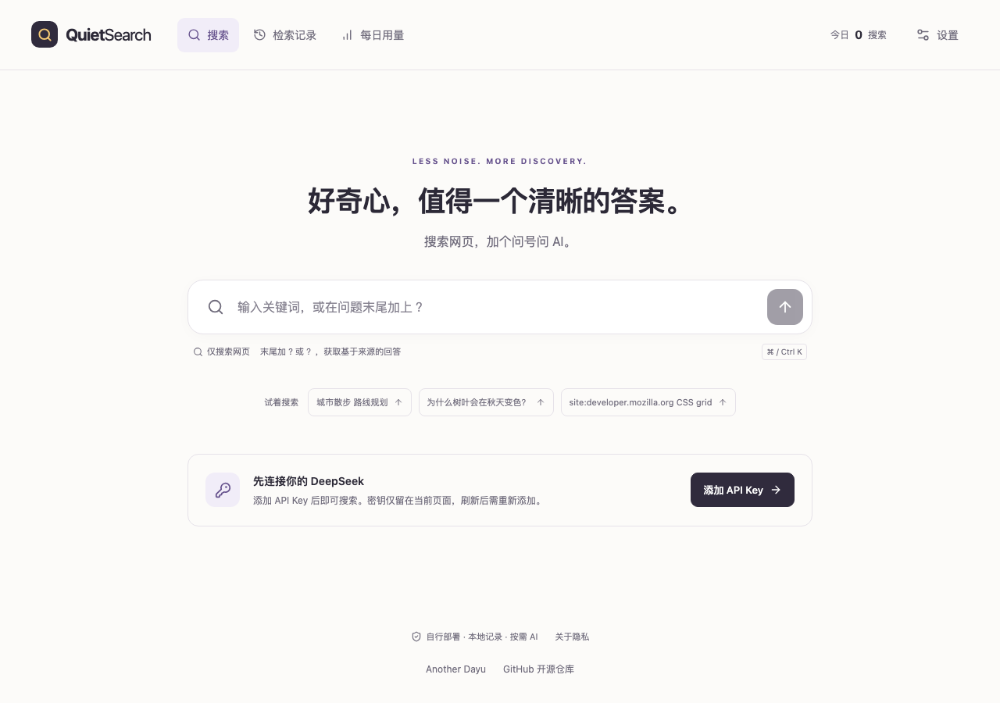
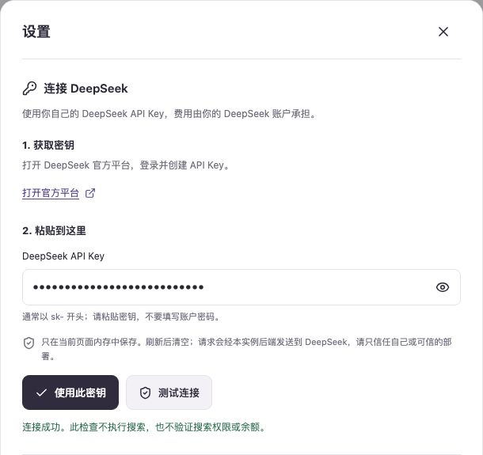
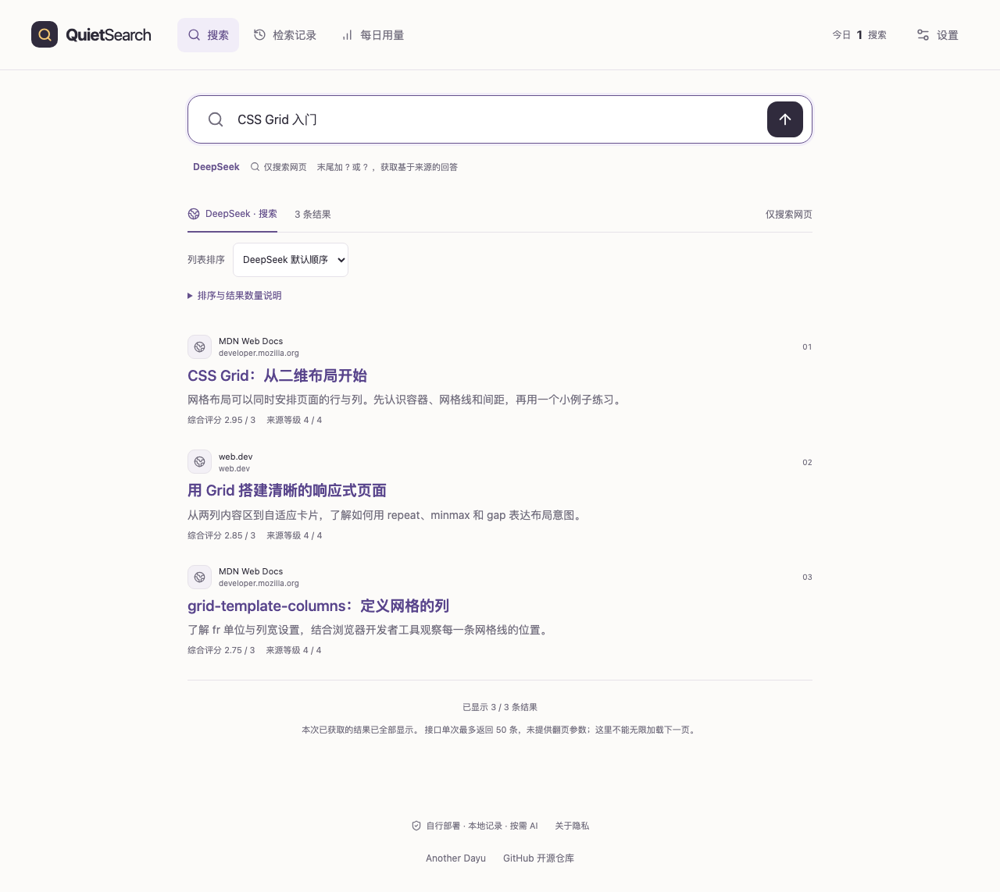
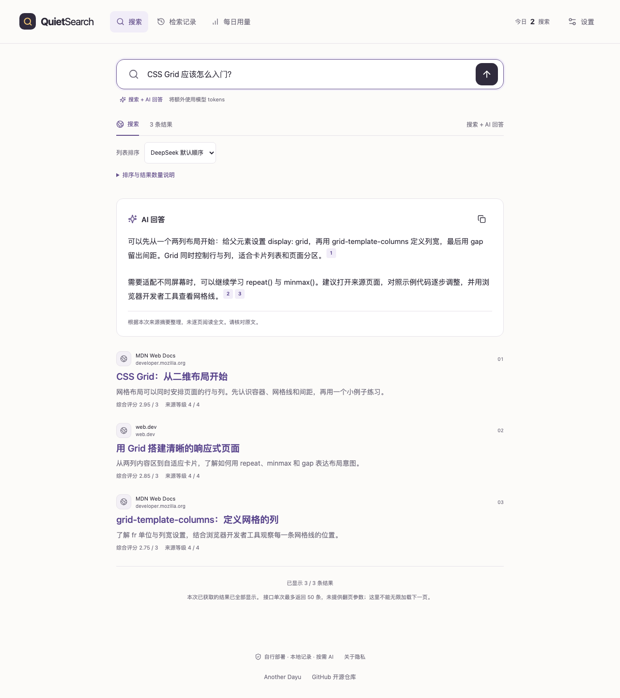
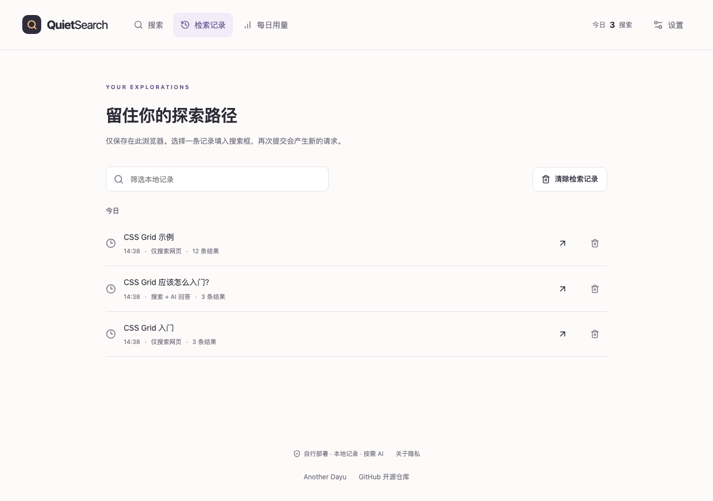
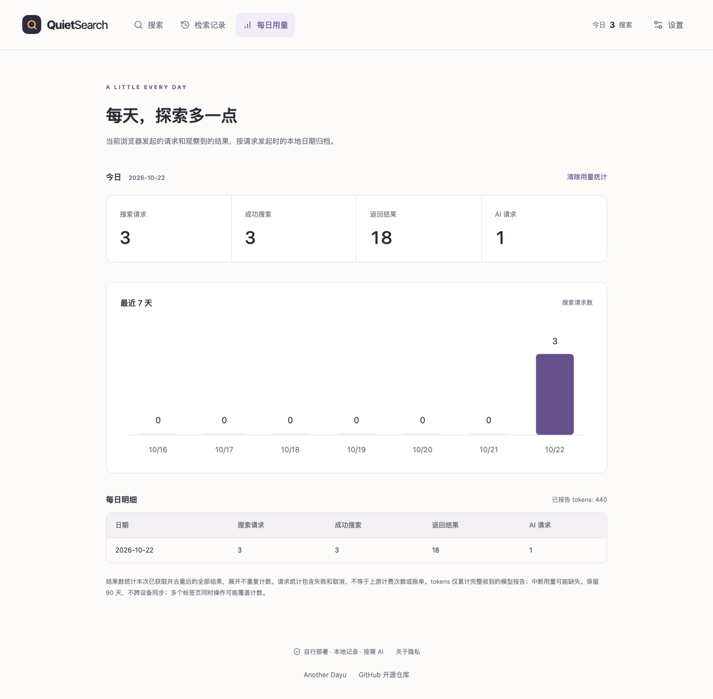
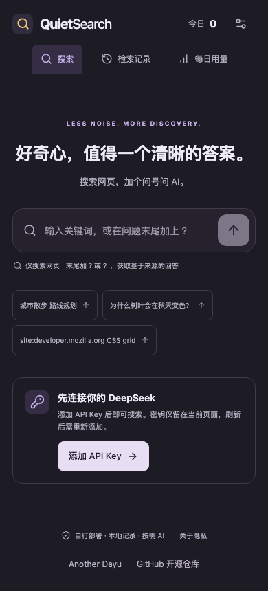

# QuietSearch

**简体中文** · [English](README.en.md)

搜索网页，加个问号问 AI。一个可以自行部署的轻量搜索工具，支持本地检索记录、每日用量、中英文和明暗主题。

**[在线体验](https://quietsearch.anotherdayu.com)** · [作者 Another Dayu](https://anotherdayu.com/) · [MIT 许可证](LICENSE)



## 开始使用

1. 到 [DeepSeek 官方平台](https://platform.deepseek.com/api_keys) 创建 API Key。
2. 打开网站，点击 **添加 API Key**，粘贴密钥。可先点 **测试连接**，再点 **使用此密钥**。
3. 关闭设置，输入内容，按 **Enter** 或点击箭头提交。

Key 只保存在当前页面内存中，刷新、换浏览器或换设备后需重新填写；请求经实例后端转发给 DeepSeek，请只使用可信实例。搜索、AI 回答和重试可能产生 API 费用；测试连接不验证余额或搜索权限。

<details>
<summary>查看 Key 设置截图</summary>



</details>

下方截图中的结果、回答、连接提示和用量均为合成演示数据，不含真实密钥或用户记录。

## 搜索与回答

| 输入示例                  | 执行内容               |
| ------------------------- | ---------------------- |
| `CSS Grid 入门`           | 只搜索网页             |
| `CSS Grid 应该怎么入门？` | 先搜索，再生成 AI 回答 |

只有提交内容末尾的 `?` 或 `？` 才会开启 AI。输入文字、选择示例词或历史记录不会自动提交。

AI 回答基于最多 6 条来源摘要；点击回答中的编号可查看原文。生成中可 **停止**，失败后可 **重试摘要**，重试沿用原问题和来源，不重新搜索。

<details>
<summary>查看普通搜索与 AI 回答截图</summary>





</details>

## 更多结果与排序

每次请求最多 **50 条**，默认先展示 **10 条**，可在设置中改为 20。列表底部的 **显示更多结果** 只展开已获取内容；切换排序也不会新增 API 请求。

默认保留 DeepSeek 顺序，也可按综合评分、来源等级或发布时间排序。上游可能返回更少结果，接口不支持无限翻页；评分不代表事实准确率。

<details>
<summary>查看“显示更多结果”按钮</summary>


</details>

## 记录、用量与外观

- **检索记录**：可筛选、填入搜索框、删除或暂停记录；仅此浏览器，最多 200 条、保留 30 天。
- **每日用量**：查看搜索次数、返回结果、AI 请求和 tokens，保留 90 天；不跨设备同步，也不是供应商账单。
- **设置 → 外观与语言**：切换主题、界面语言及每批结果数；手机也可使用。电脑端 **⌘K / Ctrl K** 快速聚焦搜索框。

<details>
<summary>查看检索记录、每日用量和手机深色界面</summary>







</details>

## 自行部署

1. [Fork 本仓库](https://github.com/DayuGuo/QuietSearch/fork)。
2. 在 Cloudflare 的 **Workers & Pages** 中导入仓库，按下表填写构建设置。
3. 部署完成后打开网址，在网页中添加自己的 Key。

| 设置           | 值                          |
| -------------- | --------------------------- |
| Build command  | `npm run build`（不能留空） |
| Deploy command | `npx wrangler deploy`       |
| Root directory | `/`                         |
| Node.js        | `24`                        |

默认使用访客自己的 Key，无需在 Cloudflare 填写 `DEEPSEEK_API_KEY`。若希望将 Key 保存在服务器，必须按[私人部署说明](docs/private-deployment.md)配合 Cloudflare Access 身份验证。

## 本地开发

需要 Node.js 24：

```bash
git clone https://github.com/DayuGuo/QuietSearch.git
cd QuietSearch
npm ci
npm run dev
```

验证与截图更新：

```bash
npm run check
npx playwright install chromium
npm run test:e2e
npm run test:runtime
npm run deploy:check
npm run screenshots
```

测试和截图使用合成数据，不调用付费 API。截图脚本生成中英文两套图片；`deploy:check` 只预检，`npm run deploy` 才会实际发布。

## 更多文档

[隐私与数据](docs/privacy.md) · [API 契约](docs/api-contract.md) · [私人部署](docs/private-deployment.md) · [验证记录](docs/verification.md) · [安全问题](SECURITY.md)

采用 [MIT](LICENSE) 许可证，依赖许可见 [THIRD_PARTY_NOTICES.md](THIRD_PARTY_NOTICES.md)。独立项目，非 Kagi 或 DeepSeek 官方产品。
